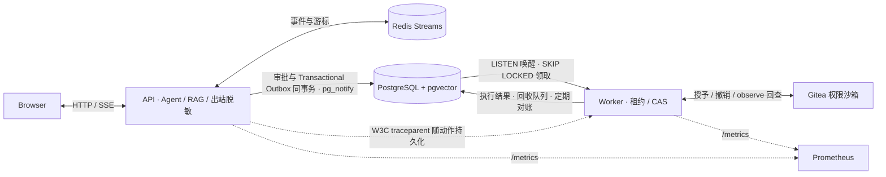

# IT-Copilot

企业 IT 服务 Agent。API 进程用 FastAPI 和 PydanticAI 接收对话、检索知识、起草变更并流式返回进度。确定性审批引擎把经过确认的变更写入 PostgreSQL；独立 Worker 领取动作，核验外部权限，处理到期回收与恢复。Redis Streams 保存可续读的对话事件。

## 系统架构



## 核心工程设计与权衡

1. **让申请人确认模型提出的变更。** 服务端从可信身份确定租户与权限，冻结目标、角色和期限。审批携带 `payload_hash`，职责分离检查申请人、受益人与审批人。
2. **审批与执行共享一次提交。** 审批通过与 outbox 入队在同一数据库事务完成。Worker 通过 `FOR UPDATE SKIP LOCKED` 争抢到期动作；`LISTEN/NOTIFY` 降低空闲唤醒延迟，轮询补偿断线和未来到期任务。当前消费方只需领取事务内的动作，引入 Kafka 会增加跨系统交付与运维成本。
3. **按外部效果恢复。** 明确失败、已生效和结果未知走不同路径。租约与版本 CAS 约束结果提交，过期执行先 `observe()`。临时授权到期时按剩余授权重新计算目标；巡检发现漂移后转入 `manual_review`，人工核对和处理留有审计记录。
4. **将连接与执行解耦。** 相同请求 ID 绑定调用者和内容指纹，重复提交订阅同一轮执行，内容变化返回 409。事件写入 Redis Streams，浏览器以 `Last-Event-ID` 续读保留窗口内的后缀。
5. **控制模型看到的数据。** BM25 与 pgvector 在授权范围内召回候选，用 RRF 融合排名。模型传输边界替换敏感值，工具参数按受控映射恢复。识别效果与残余漏检见[脱敏验收](docs/model-masking-acceptance.md)。
6. **分别管理请求和动作的生命周期。** W3C `traceparent` 随动作穿过异步边界。收到 SIGTERM 后 API 摘流，Worker 停止领取；宽限期内等待提交，取消在途操作时按是否已开始外部写入交还租约。

## 实测验收

Apple M4，16 GiB，macOS 27.0.1，CPython 3.14.6。本机回环、单轮默认负载。数据库使用临时 SQLite 文件，SSE 使用真实 Redis 8.10.3。[指标口径与复现命令](docs/benchmarks.md)

| 场景 | 实测结果 |
|---|---|
| 并发领取 | 4 个 Worker、6 个资源、48 个动作，0.734 s，65.4 actions/s。调度 P99 194.573 ms，重复执行与同资源写冲突均为 0，最终一致率 100% |
| 故障恢复 | 2 次 SIGKILL 和 1 轮对照。已生效回查命中 1 次，重复外部写 0，3/3 收敛 |
| SSE 重连 | 24 个客户端补齐 480 帧，零丢失、零重复。48 次同内容提交触发 24 次执行，24/24 次篡改返回 409。恢复 P99 81.572 ms |

## 快速开始

复制配置并填写模型服务的地址、模型名和密钥，然后启动 Compose。

```sh
cp .env.example .env
make up
```

浏览器访问 `http://127.0.0.1:8080`，API 文档在 `http://127.0.0.1:8001/docs`。用不同演示身份申请和审批。需要 Keycloak 时运行 `make up-oidc`。本地开发使用 Python 3.14 和 uv，配置可达的 Redis 及共享数据库后，在两个终端分别运行入口：

```sh
uv sync --locked
make run-api
# 另一终端
make run-worker
```

## 核心接口

| 方法与路径 | 语义 |
|---|---|
| POST /chat | 同步对话 |
| POST /chat/stream | 以 client_request_id 提交或订阅流式对话 |
| GET /chat/stream/{request_id} | 使用响应中的服务端请求 ID 和 Last-Event-ID 恢复 |
| GET /approvals | 查询身份可见的申请 |
| POST /approvals/{id}/confirm | 申请人确认草稿 |
| POST /approvals/{id} | 提交带冻结参数哈希的审批决定 |
| GET /approvals/{id}/audit | 获取审批与执行审计 |
| POST /approvals/{id}/actions/{action_id}/resolve | 处理需要人工核对的动作 |

## 项目结构

```text
src/it_copilot/
  cmd/        api、worker、bench 入口
  api/        HTTP 路由、SSE、依赖装配
  agent/      模型、脱敏、工具与检索
  workflow/   审批、持久队列、权限适配器、对账
  infra/      身份、租户、存储、事件与遥测
frontend/     浏览器客户端
config/       模型路由、权限策略与演示身份
migrations/   数据库迁移
skills/       服务台业务技能
```

## 核心配置

| 配置 | 用途 |
|---|---|
| OPENAI_BASE_URL / OPENAI_MODEL / OPENAI_API_KEY | OpenAI-compatible 模型服务 |
| IT_COPILOT_DATABASE_URL / REDIS_URL | 两个进程共享的状态库与事件服务 |
| IT_COPILOT_AUTH_MODE | dev 演示身份或 oidc |
| IT_COPILOT_MASK_MODEL | on 要求模型可用，auto 允许规则兜底，off 仅用规则 |
| IT_COPILOT_ACCESS_POLICY | 可审计的权限与审批规则 |
| IT_COPILOT_GITEA_URL / IT_COPILOT_GITEA_REPOS | 目标沙箱与系统到仓库的映射 |
| OTEL_EXPORTER_OTLP_ENDPOINT / IT_COPILOT_WORKER_METRICS_ADDR | 分布式跟踪导出与 Worker 管理端口 |

## 可观测性与验证

API 提供 `/livez`、`/readyz`、`/metrics`。Worker 配置管理地址后提供同名端点，可同时观察积压、调度延迟、租约恢复和外部权限漂移。

```sh
make lint test frontend-check
make bench BENCH_ARGS=--json
docker compose config -q
docker compose --profile oidc config -q
```
