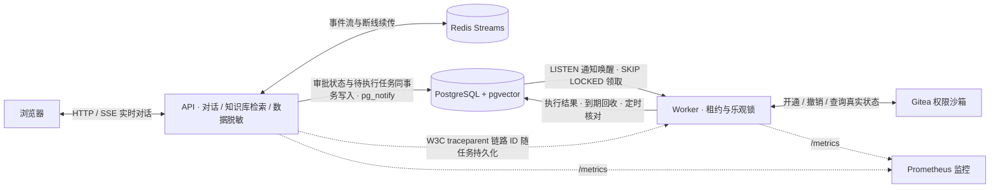

# IT-Copilot

IT-Copilot 是一个企业内部 IT 服务助手，拆分为 **API** 和 **Worker** 两个独立进程：
- **API 进程**（FastAPI + PydanticAI）：负责接收对话、搜索知识库、起草权限或工单变更，并通过 SSE 实时流式推送回复。
- **Worker 进程**：独立从 PostgreSQL 领取已审批通过的任务，调用外部系统（Gitea 权限沙箱）执行权限开通、到期自动回收以及异常状态核对。
- **Redis Streams**：保存流式对话消息，支持断线重连后从上次位置继续接收。

## 系统架构



## 核心设计说明

1. **AI 只负责提建议，真正的授权和执行由代码把关。** 服务端根据已登录的身份确定租户和权限，把模型起草的目标资源、角色和有效期冻结并生成参数校验哈希（`payload_hash`）。变更必须经过申请人确认，审批时校验审批人与申请人/受益人不是同一人，且参数哈希未被篡改。
2. **审批通过和任务入队放在同一个数据库事务里，不引入 Kafka。** 审批结果和待执行任务（本地消息表 / Transactional Outbox）在 PostgreSQL 中原子提交，避免“审批过了但消息发丢”的问题。Worker 通过 `FOR UPDATE SKIP LOCKED` 领取到期任务（多个 Worker 并发领取时不互相阻塞），借助同事务的 `pg_notify` 和 `LISTEN` 实现低延迟唤醒，并保留 5 秒定时轮询处理断线或未来到期的定时回收任务。这类低吞吐、强一致的状态流转不需要引入 Kafka 增加额外运维负担。
3. **调用外部系统失败或超时时，先查真实状态再决定要不要重试。** 外部请求的结果分为“成功、明确失败、结果未知”三种情况。Worker 领取任务时持有租约和乐观锁版本号，防止旧进程覆盖新结果；遇到结果未知或进程崩溃接管时，强制先调用只读接口查询外部真实状态，已生效就直接同步结果，不盲目重复写入。限时权限到期时会结合该用户其余有效权限重新计算最终角色；定时核对发现外部权限被人工改动导致两边不一致时，会转入人工核对（`manual_review`）并保留完整审计日志。
4. **把网络连接和后台执行解耦，支持断线续传和防重复提交。** 客户端每次流式提问携带 `client_request_id`，服务端把它和调用者、消息内容指纹绑定：相同内容重复提交会直接复用同一次执行，不会重复调用模型；相同 ID 但改了消息内容则返回 409 冲突错误。回复过程写入 Redis Streams，浏览器断线重连时带上 `Last-Event-ID` 即可从断掉的位置继续接收。
5. **在发送给模型前自动脱敏敏感信息。** 知识库检索先做权限过滤，再结合 BM25 关键词搜索和 `pgvector` 向量搜索并用 RRF 算法合并排序。所有发往大模型的文本在 HTTP 传输层自动将敏感信息替换成临时占位符，仅在调用本地工具参数时按映射还原，模型给用户的自然语言回复中不直接暴露原敏感值。识别效果与已知漏检见[数据脱敏测试说明](docs/model-masking-acceptance.md)。
6. **链路追踪跨进程贯通，支持平滑停机。** W3C `traceparent` 链路 ID 会随审批和任务写入数据库，串起对话、审批、Worker 执行、Gitea 请求和到期回收整条链路。收到 `SIGTERM` 停机信号后，API 先停止接收新流量再等当前请求结束；Worker 停止领取新任务，在停机等待时间内尽量完成正在提交的任务，对尚未发起外部写入的任务主动归还租约，方便其他 Worker 立刻接管。

## 实测验收结果

测试环境：Apple M4、16 GiB 内存、macOS 27.0.1、CPython 3.14.6。本机回环单轮默认负载，Colima 容器运行 PostgreSQL 18.4（pgvector 0.8.3）和 Redis 8.8.4。详细说明与复现命令见[性能与故障测试报告](docs/benchmarks.md)。

| 测试场景 | 实测结果 |
|---|---|
| 多 Worker 并发领取 | 4 个 Worker、6 个资源、48 个任务，耗时 0.664 s（72.25 任务/秒）。调度延迟 P99 为 105.976 ms，重复执行和同资源并发写冲突均为 0，最终一致率 100% |
| 进程强杀故障恢复 | 2 次 `SIGKILL` 强杀 Worker + 1 轮正常对照。外部已生效场景通过查询真实状态命中 1 次，重复外部写入 0 次，3/3 全部恢复一致 |
| SSE 断线重连与防重 | 24 个并发客户端补齐 480 条消息，0 丢失、0 重复。48 次同内容重复提交仅触发 24 次执行，24/24 次篡改参数返回 409，重连补齐 P99 为 102.235 ms |

## 快速开始

先复制环境变量文件，填入大模型服务的地址、模型名和 API Key，再用 Docker Compose 一键启动：

```sh
cp .env.example .env
make up
```

启动后浏览器访问 `http://127.0.0.1:8080`，后端接口文档在 `http://127.0.0.1:8001/docs`。可以在页面右上角切换演示身份（如 `alice` 发起申请、`bob` 审批）。如果需要联调 Keycloak OIDC 登录，运行 `make up-oidc`。

本地源码运行需要 Python 3.14 和 `uv`，配好数据库与 Redis 后在两个终端分别启动 API 和 Worker：

```sh
uv sync --locked
make run-api
# 另一个终端
make run-worker
```

## 核心接口

| 方法与路径 | 说明 |
|---|---|
| POST `/chat` | 普通同步对话 |
| POST `/chat/stream` | 带 `client_request_id` 发起或复用流式对话 |
| GET `/chat/stream/{request_id}` | 传入响应中的 `request_id` 和 `Last-Event-ID` 断线续传 |
| GET `/approvals` | 查询当前登录用户有权限看到的审批单 |
| POST `/approvals/{id}/confirm` | 申请人确认草稿，进入待审批状态 |
| POST `/approvals/{id}` | 提交审批决定（携带冻结参数哈希） |
| GET `/approvals/{id}/audit` | 查看审批与执行的完整审计日志 |
| POST `/approvals/{id}/actions/{action_id}/resolve` | 管理员处理进入人工核对状态的任务 |

## 项目结构

```text
src/it_copilot/
  cmd/        API、Worker 和验收测试的启动入口
  api/        HTTP 路由、SSE 推送、请求依赖组装
  agent/      大模型调用、数据脱敏、工具治理与知识库检索
  workflow/   审批状态机、数据库任务队列、外部权限适配器与定时核对
  infra/      身份认证、多租户上下文、数据库、Redis 事件流与监控日志
frontend/     React + TypeScript 前端界面
config/       模型路由、权限规则与本地演示账号
migrations/   PostgreSQL 数据库迁移脚本
skills/       IT 服务台业务说明与技能配置
```

## 常用配置

| 环境变量 | 说明 |
|---|---|
| `OPENAI_BASE_URL` / `OPENAI_MODEL` / `OPENAI_API_KEY` | 兼容 OpenAI 协议的大模型服务配置 |
| `IT_COPILOT_DATABASE_URL` / `REDIS_URL` | API 与 Worker 共享的 PostgreSQL 和 Redis 连接地址 |
| `IT_COPILOT_AUTH_MODE` | 认证模式：`dev`（本地演示身份）或 `oidc`（Keycloak） |
| `IT_COPILOT_MASK_MODEL` | 脱敏本地模型策略：`on`（强制启用）、`auto`（不可用时用规则替代）、`off`（仅用规则） |
| `IT_COPILOT_ACCESS_POLICY` | 权限与审批策略配置文件路径 |
| `IT_COPILOT_GITEA_URL` / `IT_COPILOT_GITEA_REPOS` | Gitea 沙箱地址及系统名到仓库的映射关系 |
| `OTEL_EXPORTER_OTLP_ENDPOINT` / `IT_COPILOT_WORKER_METRICS_ADDR` | OpenTelemetry 链路导出地址与 Worker 监控端口 |

## 监控与常用验证命令

API 默认暴露 `/livez`（存活检查）、`/readyz`（就绪检查）和 `/metrics`（Prometheus 指标）；Worker 配置 `IT_COPILOT_WORKER_METRICS_ADDR` 后同样提供这三个接口，用来观察任务积压、调度耗时、租约恢复以及外部权限异常情况。

```sh
make lint test frontend-check
make bench BENCH_ARGS=--json
docker compose config -q
docker compose --profile oidc config -q
```
