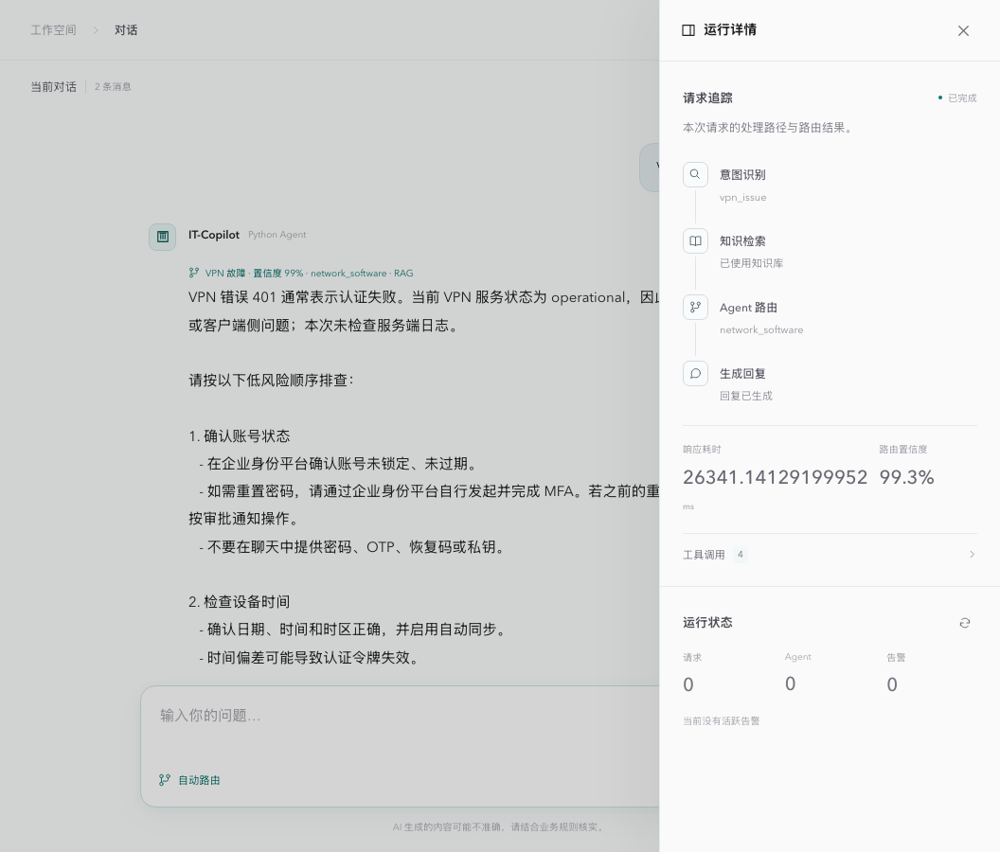
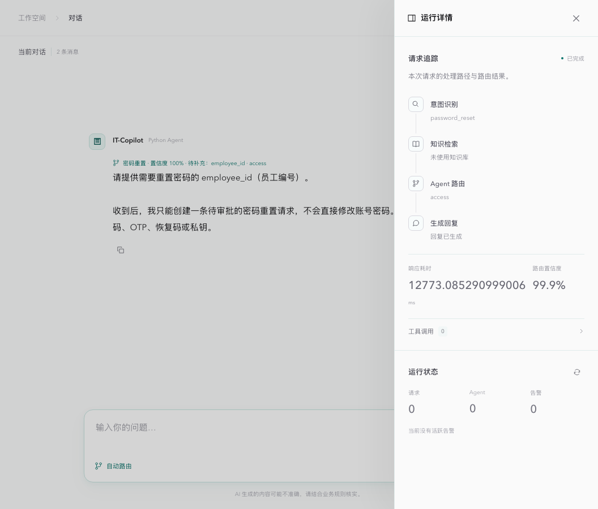
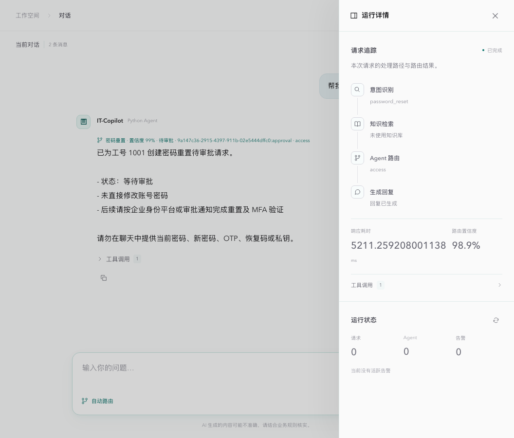

# IT-Copilot · 企业 IT 服务 Agent 平台

面向企业员工报障、账号权限申请与工单协作，提供从自然语言受理、知识检索、任务编排到人工审批、业务执行和审计追踪的完整处理链路。员工通过对话提交诉求，IT 支持人员查看诊断证据与执行记录，审批人员确认冻结的变更参数后触发业务操作。

项目围绕企业 IT 服务的四个工程问题展开：多轮请求如何保持业务上下文，模型调用工具如何受到明确约束，变更如何在身份、审批与外部系统故障下可靠执行，以及如何依据实际业务状态验收结果。身份来自 OIDC（Keycloak），审批与执行状态落在 PostgreSQL，`gitlab` 权限经 Gitea 沙箱真实生效并到期回收；生产 IAM/ITSM 仍需按同一适配器契约接入。

## 业务场景与交付能力

| 业务场景 | 处理流程 | 可核验的交付结果 |
|---|---|---|
| 员工报障 | 结构化分流、多轮补槽、知识检索与诊断 | 带来源的知识结果、工具证据与处理建议 |
| 账号与权限申请 | 按登录身份与版本化策略校验，冻结请求；审批人与申请人分离，高权限需双人批准 | 目标系统（Gitea / 本地目录）中的权限、执行回执与审批审计 |
| 限时授权与回收 | 授权成功即在同一事务登记到期回收；回收前核对权限是否被他人改动 | 到期自动撤销，原有权限与被他人修改的权限不被误删 |
| 故障转工单 | 将前序诊断证据传入工单步骤，补齐信息后申请审批 | 本地持久化工单；前序失败时阻断依赖步骤 |
| 服务运行治理 | 采集调用成功率、延迟与链路事件，触发降级和恢复探针 | 请求 trace、监控指标、失败原因及离线回归记录 |

## 工程设计重点

- **可信身份与职责分离**：调用者身份只来自已验证的 JWT（OIDC / 开发模式），请求体中的用户、部门、审批人一律不采信；trace、审批、审计、员工状态按对象归属授权；申请人不能审批自己的申请或针对自己账号的申请，开发者权限需两名不同审批人。
- **策略即代码**：`config/access_policy.yaml` 定义可申请的系统/角色、审批人数、最长有效期与代他人申请的角色；审批快照记录策略版本。模型只能提出申请，策略由工具和审批库两次校验，知识库文本无法改变它。
- **可恢复的受控执行**：审批通过与执行动作在同一事务写入（outbox），带租约的 worker 以版本号 CAS 认领；外部调用分为确定失败 / 可重试 / 结果未知三类，结果未知先回查目标系统再决定是否重做；批量中途失败按 saga 撤销已授予的权限，不可逆变更转人工复核。
- **实时执行流与统一工具治理**：意图、路由、工具开始/结束、审批等事件在执行中写入 Redis Streams，SSE 实时推送并支持 `Last-Event-ID` 断线续传；所有 Agent 工具经同一执行层（超时、熔断、只读重试、写操作幂等键）。
- **可观测与可验收**：Prometheus / OpenTelemetry 关联运行指标与调用轨迹；安全回归、PostgreSQL 并发、真实 Keycloak/Gitea 集成在 CI 中运行；真实模型实验以业务状态断言判定成功并保留失败样本。

当前边界：本项目不宣称跨系统 exactly-once（外部系统无幂等键时依靠目标状态回查）；Gitea 是权限系统的沙箱替身，不是企业 IAM。详见 [设计取舍](docs/design-tradeoffs.md)、[ADR](docs/adr/) 与 [威胁模型](docs/threat-model.md)。

## 架构

```mermaid
flowchart LR
  U[Web 前端] -- OIDC PKCE --> KC[Keycloak]
  U -- Bearer JWT --> API[FastAPI /chat · /chat/stream]
  API -. JWKS 校验 .-> KC
  API --> I[结构化意图识别]
  I --> P[规划策略：默认通用 Agent / LLM 规划多 Agent + 性能路由]
  P --> A[Agent 池 / 通用 / Triage / Endpoint / Access / Network / Ticket]
  A --> G[PydanticAI Agent / 工具循环 / 结构化输出]
  G --> GW[8082 Anthropic 协议网关 或 OpenAI 直连]
  A --> T[工具治理 / Schema / TTL / timeout / circuit breaker]
  A --> R[混合 RAG / BM25 + Chroma + RRF]
  A --> M[三级记忆 / Redis + Chroma]
  T --> H{审批门 / 策略 + 职责分离}
  H -->|approved: 同事务写入 outbox| DB[(PostgreSQL 审批 / 动作 / 授权台账 / 审计)]
  DB --> W[执行 worker / 租约 + CAS / 回查对账 / 到期回收]
  W --> GT[Gitea 沙箱 · gitlab 权限]
  W --> LD[本地目录 · 账号 / 工单]
  H -->|pending/rejected| O[可解释结果]
  A -. 执行事件 .-> ES[Redis Streams] -. SSE 续传 .-> U
  A -.-> MCP[外部 MCP 工具 / 只读白名单]
  API --> X[/trace + /metrics + /monitor]
  X --> MON[监控闭环 / SLO 燃烧率 / 告警 / 降级与探针恢复]
  MON -.路由降权.-> P
  API --> MS[/mcp 对外暴露知识库]
```

## 核心能力

- 基于 PydanticAI 的结构化意图输出（`classify_it_request`）、多轮补槽和纠正；默认 LLM 主路由、失败时标记规则兜底，保留三路融合消融开关。温度参数按模型/来源隔离，默认不启用旧的样本内拟合。
- 四种规划策略（`IT_COPILOT_PLANNING_MODE`）：`generalist`（默认，一个 Agent 持有全部工具）、`bounded`（LLM 规划 + Triage/Endpoint/Access/Network/Ticket 专职 Agent，按领域隔离工具）、`bounded_all`、`single`；支持性能路由与降级兜底。
- 向量、BM25、Hybrid 三种检索，Hybrid 使用 RRF 合并并返回 citation。
- 多 Agent 规划：LLM 结构化输出计划（失败回退规则规划器），最多 4 步，只在用户要求时建单；独立步骤并行，依赖证据传入下游，前置失败阻断依赖；token 预算按步骤数计算，在波次间检查。
- Redis 分布式锁、`client_request_id` 幂等回执、工作/情景/画像三级记忆。
- 写操作先生成绑定参数哈希与策略版本的审批；同一会话的新申请替代仍待审批的旧申请，避免重复建单；达到审批人数后由 outbox worker 执行，权限类变更写入 Gitea 或本地目录并按有效期自动回收；动作级审计可回放。
- 实时 SSE 执行事件（可续传）、按归属授权的请求 trace、离线评测与 21 项安全回归。
- 可观测性闭环：事件处埋点的 Prometheus 指标、PydanticAI → OpenTelemetry 链路追踪、SLO 多窗口燃烧率告警，Agent 持续失败时自动降级到 Triage 兜底并以单探针恢复。
- 标准 MCP（2.x SDK）双向接入：外部 MCP 工具经治理层（Schema/缓存/熔断/指标）按白名单下发给指定 Agent；本地知识库以 `/mcp/` 端点对外提供。

## 技术栈

| 层 | 实现 |
|---|---|
| API | Python 3.14（uv 管理）、FastAPI、Pydantic |
| Agent 框架 | PydanticAI：Agent 工具循环、`Tool.from_schema`、`ToolOutput` 结构化输出、`UsageLimits` 轮数上限 |
| 模型接入 | 默认 PydanticAI AnthropicModel → 本地 Anthropic→OpenAI 协议网关（8082）；`IT_COPILOT_LLM_PROVIDER=openai` 时直连 OpenAI-compatible |
| 身份 | OIDC（Keycloak 26，授权码 + PKCE；API 侧 JWKS 校验 RS256），开发/评测用本地签发令牌；RBAC：employee / approver / it_admin / auditor |
| 存储 | PostgreSQL 17（审批、动作 outbox、授权台账、审计；本地与测试用 SQLite），SQLAlchemy Core + Alembic 迁移；Redis（锁/幂等/工作记忆/事件流）、Chroma（知识与向量记忆） |
| 执行 | outbox + 租约 worker（API 内与独立进程可并存），适配器：Gitea REST（真实权限系统沙箱）、本地目录 |
| RAG | BM25、向量检索、RRF、部门过滤 |
| 前端 | Vue 3、Vite、原生 SSE |
| 工具协议 | MCP Python SDK 2.x（Streamable HTTP / stdio 客户端，MCPServer 服务端） |
| 可观测性 | Prometheus 指标、OpenTelemetry（OTLP → Jaeger）、进程内 SLO 告警、Grafana 仪表盘 |
| 部署 | Docker Compose：postgres / keycloak / gitea（含初始化任务）/ redis / gateway / api / worker / frontend，`observability` profile 加 Prometheus / Grafana / Jaeger |
| 质量 | GitHub Actions（lint、离线测试、PostgreSQL、Keycloak+Gitea 集成、前端）、pytest、node:test、LLM-as-Judge 框架、离线评测脚本 |

## 实验与证据（v3 新增）

可复现命令与口径见 [v3 评测说明](docs/evaluation-v3.md)。

| 实验 | 结果与口径 |
|---|---|
| 安全回归 | 21 个攻击用例（伪造/篡改/过期/alg=none 令牌、请求体冒充、跨用户读取、职责分离、策略越界、哈希篡改与并发重放、知识库提示注入 + 完全听从注入的模型）：未授权写入 0、未授权读取 0；对两处防护做变异测试均被检出。离线脚本化模型，不代表真实攻击面全集 |
| 实时事件流 | 真实 uvicorn + TCP、模拟 0.8s/次模型时延、20 次：首个执行事件 P50 0.93s，整轮完成 P50 2.56s；旧 SSE 在整轮完成后才发出首个执行事件 |
| 工作流并发 | 13 项工作流测试（并发批准、双人审批并发投票、结果未知回查、worker 崩溃恢复、saga 补偿、到期回收与漂移保护、待审批申请替代）在 SQLite 与 PostgreSQL 17 上均通过；其中前 12 项各重复 5 次 |
| 真实系统集成 | Keycloak 令牌映射 / 篡改与受众校验；Gitea 授权 → 到期撤销 → 他人改动后不误删，均对真实服务运行 |
| 单/多/通用 Agent 分层对照 | 64 场景（单领域/双领域/三领域/多轮/不应写入）× 2 个独立进程。修复前：single 40/64、多 Agent 44/64、通用 Agent 63/64，多 Agent 落后来自规则规划器漏领域、未要求时追加建单和预算不足。改为 LLM 规划器、只在用户要求时建单、按步骤数计算预算后，在完成重跑的 42 个场景上多 Agent 从 26/42 升到 41/42，每个 Agent 带全部工具的 bounded_all 为 42/42，通用 Agent 为 40/42，三者无显著差异；多 Agent token 多约 60% |
| τ-bench 式多轮评测 | 50 个组合任务（1–3 个子任务 + 违规请求），LLM 模拟用户只在被问到时透露信息，按审批执行后的员工最终状态评分，报告 pass^1 / pass^2。评测发现四种策略共有的重复建单缺陷（修复前占失败的 72%），已改为同会话新申请替代仍待审批的旧单。服务端额度耗尽前完成的 33 个任务上，pass^1 为：多 Agent 0.85、bounded_all 0.80、通用 0.80、单专职 0.62 |
| 真实模型回归 | DeepSeek `deepseek-flash`，新身份/审批流程下重跑 v2 场景：开发集 single 24/24、bounded 23/24；留出集 36/36、36/36（v2：23/24、22/24、36/36、33/36）。提升来自修复复合诊断建单：计划预算 12k→30k、诊断 Agent 开放仅生成审批的建单工具、模型轮数 3→5（预算后续改为按步骤数计算，见下一行）；bounded token 约为 single 的 2.5–3 倍。首轮因评测脚本缺陷作废，过程见评测说明 |

## 实验与证据（v2）

指标来自本地演示业务环境，不是生产流量。完整协议、失败案例与限制见 [评测说明](docs/evaluation-v2.md)。

| 实验 | 结果与口径 |
|---|---|
| 意图消融 | 88 条人工编写样本，44 校准 / 44 留出；真实 DeepSeek Flash：LLM 与融合均 44/44；未证明融合更优，默认采用较简单的 LLM 路由 |
| RAG | 60 文档、40 查询：Recall@3 为 BM25 0.95 / vector 0.525 / hybrid 0.725；12 条配对子集改写重排后 0.9167，原 hybrid 0.75 |
| 业务开发集 | 24 场景 × 2 策略，真实模型与 Redis/Chroma/SQLite；组合修复前 single/bounded 均 13/24，之后 23/24 与 22/24；这是开发集回归 |
| 独立应用验证 | 另冻结 12 场景，每策略重复 3 次：single 36/36、bounded 33/36（3 次预算停止）；详见 `evaluation/reports/application_holdout_live.json`，不将开发集改善当泛化结果 |
| 记忆对照 | 每模式 4 项确定性上下文检查：working 2/4、state 3/4、full 4/4；不是用户对话成功率 |
| 故障恢复 | 并发批准/拒绝、重复执行、批次回滚、子进程退出后重试有回归测试；10 次模型故障注入验证降级和单探针恢复 |

历史 `*_latest.json` 的 47/47 意图结果是 **LLM 关闭的本地兜底**；6 文档/20 查询的 RAG 和样本内校准报告仅保留为旧 smoke 基线。不得用其宣称真实融合准确率、生产召回率或回答忠实度。

## 快速开始

```bash
cd IT-Copilot
uv venv --python 3.14 && uv pip install -r requirements-dev.txt   # start_local.sh 缺依赖时也会自动安装
cp .env.example .env
cp gateway/.env.gateway.example gateway/.env.gateway  # 填入未提交的兼容密钥
./start_local.sh
```

脚本会确保 Redis 容器 `it-copilot-redis`、8082 网关、8001 API 和 5173 前端就绪。本地默认 `IT_COPILOT_AUTH_MODE=dev`：前端自动以演示员工 alice 登录，可在“连接配置”切换为审批人 bob/carol、管理员 erin 或审计员 grace 体验职责分离；审批库默认是 `data/chroma/workflow.sqlite3`。若在 `.env` 中设置 `IT_COPILOT_LLM_PROVIDER=openai` 并填写 `OPENAI_BASE_URL`/`OPENAI_API_KEY`/`OPENAI_MODEL`，PydanticAI 会直连上游，脚本跳过网关。浏览器打开 <http://127.0.0.1:5173>，可尝试：`VPN 连不上`、`申请 GitLab 只读权限`、`查询我的工单`。API 文档：<http://127.0.0.1:8001/docs>。

### Docker Compose

```bash
cp .env.example .env
cp gateway/.env.gateway.example gateway/.env.gateway   # 填入上游模型配置
docker compose up -d --build                           # 前端 http://127.0.0.1:8080 · API http://127.0.0.1:8001/docs
                                                       # Keycloak :8180（演示账号 <用户名>-pass）· Gitea 沙箱 :3001
docker compose --profile observability up -d           # Grafana :3000（admin / it-copilot）· Prometheus :9090 · Jaeger :16686
```

Compose 默认 `IT_COPILOT_AUTH_MODE=oidc`，前端跳转 Keycloak 登录；`gitlab` 权限申请通过 Gitea 沙箱仓库 `it-sandbox/platform` 生效，可在 Gitea 中直接看到协作者变化。开启链路追踪：在 `.env` 中设置 `OTEL_EXPORTER_OTLP_ENDPOINT=http://jaeger:4317` 后重启 api。对外部署前替换所有默认口令并关闭 Keycloak 密码模式（`directAccessGrantsEnabled`）。

分步启动可使用 `./gateway/run_gateway.sh`、`./run_local.sh` 与 `cd frontend && npm ci && npm run dev -- --host 127.0.0.1 --port 5173`。真实密钥只允许出现在未被 Git 跟踪的 `gateway/.env.gateway`。

## 评测与观测

```bash
python -m ruff check .                     # 未使用导入、未定义名称和语法检查
python -m pytest -q
cd frontend && npm test && npm run build
cd .. && python scripts/evaluate_all.py     # 离线门禁：意图 / 记忆 / RAG / Planner / 安全，不调用模型
python scripts/evaluate_security.py         # 21 项安全回归（也在 pytest 中运行）
python scripts/benchmark_stream.py          # 实时事件流首事件时延（真实 TCP，模拟模型时延）
IT_COPILOT_TEST_DATABASE_URL=postgresql+psycopg://... pytest tests/test_workflow.py   # 工作流测试跑在 PostgreSQL
python scripts/calibrate_intents.py         # 从 v2 报告的 calibration 子集拟合候选；--install 显式安装
python scripts/evaluate_application.py      # 在线：真实 HTTP 链路、业务状态断言；使用独立 Redis :16379
python scripts/judge_application_report.py  # 对已保存轨迹补充 Judge 评分，不改变业务判定
# 在线：τ-bench 式多轮评测，每种策略一个进程（--redis-url 用不同 db），总并发不要超过模型服务商的并发上限
python scripts/evaluate_simulated.py --strategies generalist --output simulated_v4_generalist_run1.json
python scripts/compare_strategies.py evaluation/reports/simulated_v4_*_run*.json --exclude-errored [--exclude-simulator-flags]
```

运行时入口：`GET /metrics`、`GET /monitor`（SLO 燃烧率、触发中的告警与处置建议、Agent/工具/MCP 健康度）、`GET /trace/{request_id}`、`GET /eval/reports`；流式接口：`POST /chat/stream`，断线后 `GET /chat/stream/{request_id}` + `Last-Event-ID` 续读。执行在后台任务中进行，与连接解耦：客户端断开不会取消执行，相同 `client_request_id` 重复提交只订阅已有执行。正文目前是最终回答分片，不是模型 token 流。前端“运行与评测”页每 15 秒刷新上述状态。

### 监控设计

| 层 | 做法 |
|---|---|
| 采集 | 在事件发生处埋点（`monitor/metrics.py`）：Agent 结果与失败原因、token、工具调用结果与熔断状态、意图来源/澄清/继承、知识库命中、审批事件、MCP 连接；低基数标签，不含 user_id |
| 追踪 | 每次 `/chat` 一个根 span，PydanticAI 自动生成模型调用与工具调用子 span；默认不记录 prompt 内容 |
| 判断 | 可用性 / 延迟两个 SLO（默认 95%），按 Google SRE 多窗口多燃烧率告警：1h&5m > 14.4x 为 critical，6h&30m > 6x 为 warning；Agent / 工具用近 5 分钟窗口，不用累计值 |
| 告警 | 状态机：触发、升级、恢复各通知一次（可配 Webhook），连续两个周期正常才恢复；同一套规则也以 PromQL 形式提供给 Prometheus（`config/prometheus/alerts/`） |
| 反馈 | 近期表现转为路由降权；超阈值的专职 Agent 进入冷却，请求由 Triage 兜底；冷却结束只放行一个探针，成功即恢复 |

### 外部 MCP 工具

在 `.env` 中设置 `IT_COPILOT_MCP_ENABLED=true` 后，API 启动时后台连接 `config/mcp_servers.json` 中的服务（默认：微软 Learn 文档检索，适合 Windows / Office / Entra ID 类问题）。只接收服务端标注 `readOnlyHint` 且在 `allowed_tools` 白名单内的工具，按 `agents` 字段下发；连接断开时工具自动从 Agent 移除。默认关闭，因为开启后员工问题可能被发送到第三方。

本地知识库同时以 MCP 服务对外提供：`http://127.0.0.1:8001/mcp/`（工具 `search_local_knowledge`、资源 `it-copilot://knowledge/stats`），可直接配置到 Claude Desktop / Cursor 等客户端。

## 项目结构

```text
api/          FastAPI 路由、鉴权依赖、实时 SSE、审批、trace、知识库写入与 /mcp 挂载
workflow/     审批库（CAS、职责分离、outbox）、执行 worker、策略加载
adapters/     目标系统适配器：Gitea、本地目录；失败分类契约
migrations/   Alembic 迁移
deploy/       Keycloak realm（由 config/dev_users.yaml 生成）
agents/       Agent profile、池化、路由、并行协作（PydanticAI Agent + 工具包装）
core/         意图、Planner、身份（identity.py）、事件流（events.py）；core/llm.py 为 PydanticAI 模型工厂
memory/       Redis 锁、幂等、三级记忆
tooling/      统一工具执行层（executor.py）、Schema、TTL、超时、熔断；MCP 客户端与服务端
monitor/      Prometheus 指标定义、SLO 燃烧率与告警状态机、路由反馈
gateway/      本地协议转换网关
frontend/     Vue + Vite 前端
evaluation/   固定数据集与可复现报告
tests/        后端离线回归、真实 HTTP 处理链路与崩溃恢复测试
config/       访问策略、演示身份目录、MCP 服务、Prometheus 规则、Grafana 仪表盘
docs/         设计取舍、ADR、威胁模型、评测说明与截图
```

## Mock 与生产替换边界

| 组件 | 当前实现 | 生产替换 |
|---|---|---|
| 身份 | Keycloak（compose）/ 本地签发的开发令牌（测试、评测） | 企业 IdP（OIDC），同一组 claims：`employee_id`、`department`、`roles` |
| 权限系统 | `gitlab` → Gitea 沙箱仓库协作者；`jira` / `vpn` → 本地目录 | 实现 `adapters/base.py` 契约（preflight / current_level / apply / observe）的 IAM 适配器；支持幂等键的系统应透传 action id |
| 账号与工单 | 本地目录（`directory_*` 表），效果与操作 ID 同事务提交 | ITSM / 目录服务适配器 |
| 资产、服务状态、工单查询 | mock | 只读适配器 |

审批快照冻结参数、申请人与策略版本；`approved` 与执行状态分开，执行状态包括 `queued / executing / succeeded / failed / manual_review`。结果持续未知的动作进入 `manual_review`，IT 管理员可调用 `/approvals/{id}/reconcile` 让 worker 先回查目标系统再决定是否重做。所有状态迁移写入 `/approvals/{id}/audit`。

## 文档

- [模块设计与 trade-off](docs/design-tradeoffs.md)
- [架构决策记录（ADR）](docs/adr/)
- [威胁模型](docs/threat-model.md)
- [v3 评测说明：安全、实时流、工作流与集成](docs/evaluation-v3.md)
- [变更记录](CHANGELOG.md)

## 界面演示

<p align="center">
  <br>
  <em>只读问答：意图识别 + 混合检索 RAG，回答引用知识库证据</em>
</p>

<p align="center">
  <br>
  <em>缺槽位澄清：写操作信息不全时先反问，不执行任何写工具</em>
</p>

<p align="center">
  <br>
  <em>待审批（HITL）：写操作只生成 pending_approval，人工批准后才执行</em>
</p>

## License

MIT，见 [LICENSE](LICENSE)。
