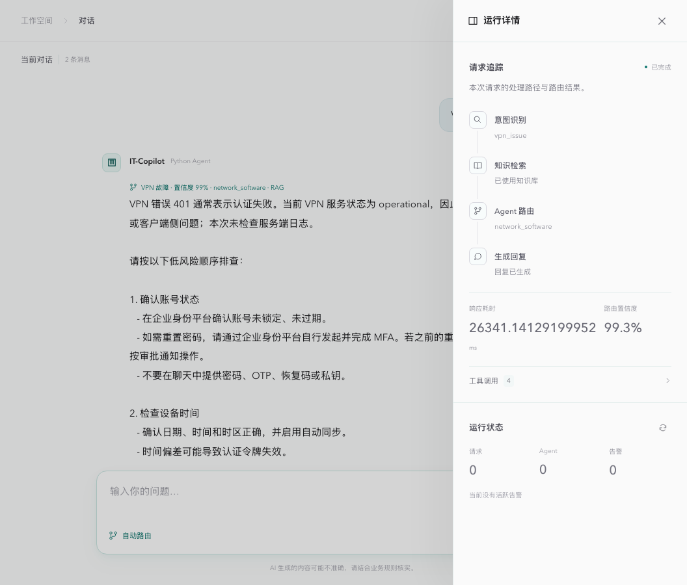
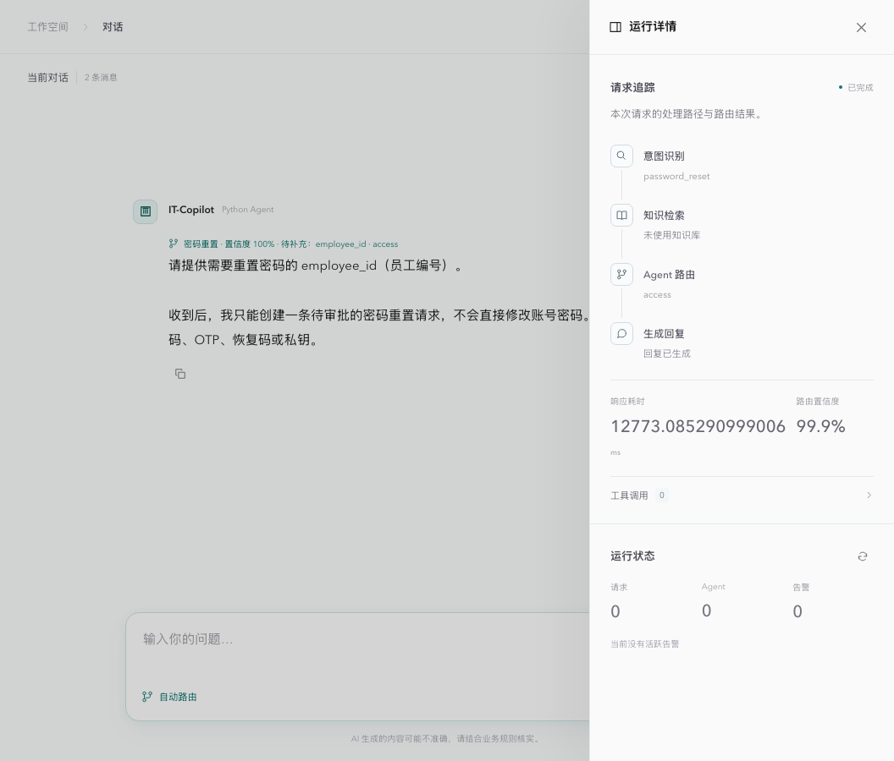
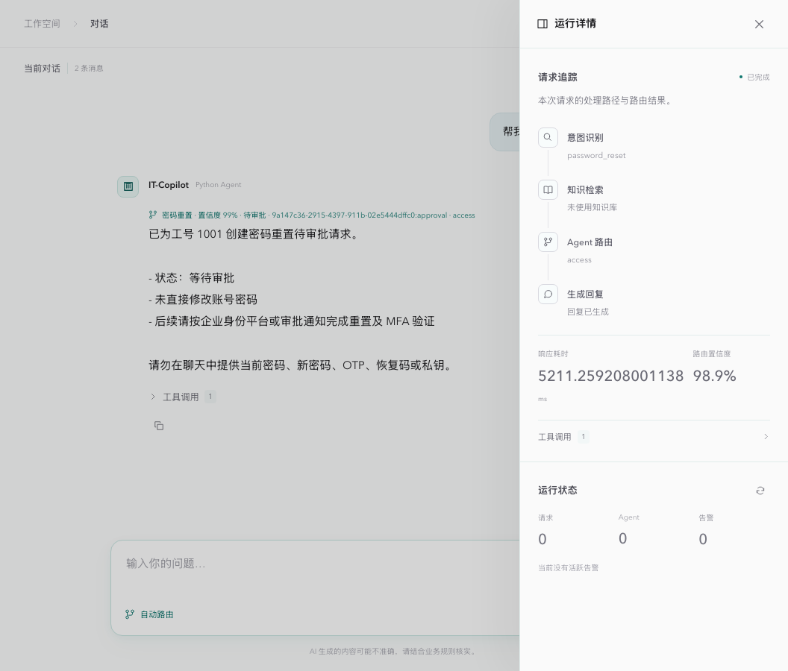

# IT-Copilot · 企业 IT 服务 Agent 平台

面向企业员工报障、账号权限申请与工单协作，提供从自然语言受理、知识检索、任务编排到人工审批、业务执行和审计追踪的完整处理链路。员工通过对话提交诉求，IT 支持人员查看诊断证据与执行记录，审批人员确认冻结的变更参数后触发业务操作。

项目围绕企业 IT 服务的四个工程问题展开：多轮请求如何保持业务上下文，模型调用工具如何受到明确约束，变更如何在身份、审批与外部系统故障下可靠执行，以及如何依据实际业务状态验收结果。身份来自 OIDC（Keycloak），审批与执行状态落在 PostgreSQL，`gitlab` 权限经 Gitea 沙箱真实生效并到期回收；生产 IAM/ITSM 仍需按同一适配器契约接入。

## 业务场景与交付能力

| 业务场景 | 处理流程 | 可核验的交付结果 |
|---|---|---|
| 员工报障 | 结构化分流、多轮补槽、知识检索与诊断 | 带来源的知识结果、工具证据与处理建议 |
| 账号与权限申请 | 按登录身份与版本化策略校验，冻结请求；审批人与申请人分离，高权限需双人批准 | 目标系统（Gitea / 本地目录）中的权限、执行回执与审批审计 |
| 限时授权与回收 | 授权成功即在同一事务登记到期回收；回收前核对权限是否被他人改动；用完可提前归还，待审批申请可由申请人撤回 | 到期或提前归还时撤销，原有权限与被他人修改的权限不被误删 |
| 故障转工单 | 将前序诊断证据传入工单步骤，补齐信息后申请审批 | 本地持久化工单；前序失败时阻断依赖步骤 |
| 设备丢失 | 员工申请远程锁定本人设备，经审批后执行，执行前核对设备归属 | 沙箱设备台账中的锁定状态与执行回执 |
| 服务运行治理 | 采集调用成功率、延迟与链路事件，触发降级和恢复探针 | 请求 trace、监控指标、失败原因及离线回归记录 |
| 飞书群报障 | 群里 @ 机器人或私聊，话题内追问免 @；与网页走同一条对话与审批链路 | 话题内答复；审批结果（批准执行、拒绝、过期、策略失效）回推到原话题 |
| 策略变更 | 改 `access_policy.yaml` 无需重启；按新版本复核在途工作，只收紧不放宽 | 失效的待审批单、取消的未执行动作、提前回收的授权，均有审计 |

## 工程设计重点

- **可信身份与职责分离**：调用者身份只来自已验证的 JWT（OIDC / 开发模式），请求体中的用户、部门、审批人一律不采信；trace、审批、审计、员工状态按对象归属授权；申请人不能审批自己的申请或针对自己账号的申请，开发者权限需两名不同审批人。
- **策略即代码**：`config/access_policy.yaml` 定义可申请的系统/角色、审批人数、最长有效期与代他人申请的角色；审批快照记录策略版本。模型只能提出申请，策略由工具和审批库两次校验，知识库文本无法改变它。
- **可恢复的受控执行**：审批通过与执行动作在同一事务写入（outbox），带租约的 worker 以版本号 CAS 认领；外部调用分为确定失败 / 可重试 / 结果未知三类，结果未知先回查目标系统再决定是否重做；批量中途失败按 saga 撤销已授予的权限，不可逆变更转人工复核。
- **实时执行流与统一工具治理**：意图、路由、工具开始/结束、审批等事件在执行中写入 Redis Streams，SSE 实时推送并支持 `Last-Event-ID` 断线续传；所有 Agent 工具经同一执行层（超时、熔断、只读重试、写操作幂等键）。
- **策略变更即时复核**：策略文件按修改时间热加载；版本变化后，旧版本下的待审批单失效或提高审批人数，未执行的动作取消，生效中的授权按新上限提前回收；审批人决定前、worker 执行第一个动作前都会再查一次（[ADR 0008](docs/adr/0008-revalidate-on-policy-change.md)）。
- **IM 入口**（借鉴 DeepSeek dsh-superagent）：飞书消息先落库再处理，回复与审批通知走出站 outbox，按会话保序、退避重试、幂等去重；只在被叫到时说话，一次请求最多一次回应、一次答复、一次结果通知（[ADR 0009](docs/adr/0009-feishu-channel-stored-work.md)）。
- **共享事项会话**：申请人、受邀或指定的审批人与 Agent 在同一网页事项中讨论。消息内嵌审批卡片，支持「同意审批」「拒绝申请」「要求补充说明」；正式投票独立留痕，讨论不代替审批。持久化任务层通过独立事件源接收审批结果并唤醒只读跟进，重启后可恢复；任务存储、Agent 执行、审批业务与网页交互通过接口组合，共享上下文不读取私人聊天记忆（[ADR 0012](docs/adr/0012-shared-service-tasks.md)、[当前访问规则](docs/adr/0016-identity-scope-and-task-history.md)）。
- **用户隔离与历史流程续接**：私聊记忆、回执和事件流按“租户＋用户”隔离；共享事项使用显式成员权限。私聊可召回本人发起事项的当前摘要，网页可按权限查找、关联并继续原流程；关联不复制讨论或授予源事项权限（[ADR 0016](docs/adr/0016-identity-scope-and-task-history.md)）。
- **可观测与可验收**：Prometheus / OpenTelemetry 关联运行指标与调用轨迹；安全回归、PostgreSQL 并发、真实 Keycloak/Gitea 集成在 CI 中运行；真实模型实验以业务状态断言判定成功并保留失败样本。

当前边界：本项目不宣称跨系统 exactly-once（外部系统无幂等键时依靠目标状态回查）；Gitea 是权限系统的沙箱替身，不是企业 IAM。详见 [设计取舍](docs/design-tradeoffs.md)、[ADR](docs/adr/) 与 [威胁模型](docs/threat-model.md)。

## 架构

```mermaid
flowchart LR
  U[Web 前端] -- OIDC PKCE --> KC[Keycloak]
  FS[飞书] -- 事件回调 --> IN[(channel_inbox)] --> API
  DB -. 审批结果 .-> OUT[(channel_outbox)] -. 回复/通知 .-> FS
  U -- Bearer JWT --> API[FastAPI /chat · /chat/stream]
  API -. JWKS 校验 .-> KC
  API --> I[结构化意图识别]
  I --> P[规划策略：默认通用 Agent / LLM 规划多 Agent + 性能路由]
  P --> A[Agent 池 / 通用 / Triage / Endpoint / Access / Network / Ticket]
  A --> G[PydanticAI Agent / 工具循环 / 结构化输出]
  G --> GW[OpenAI-compatible 模型服务（DeepSeek）]
  A --> T[工具治理 / Schema / TTL / timeout / circuit breaker]
  A --> R[混合 RAG / BM25 + pgvector（jina-v2-base-zh）+ RRF]
  A --> M[三级记忆 / Redis + pgvector]
  T --> H{审批门 / 策略 + 职责分离}
  H -->|approved: 同事务写入 outbox| DB[(PostgreSQL 审批 / 动作 / 授权台账 / 审计)]
  DB --> W[执行 worker / 租约 + CAS / 回查对账 / 到期回收]
  W --> GT[Gitea 沙箱 · gitlab 权限]
  W --> LD[本地目录 · 账号 / 工单]
  H -->|pending/rejected| O[可解释结果]
  A -. 执行事件 .-> ES[Redis Streams] -. SSE 续传 .-> U
  A -.-> MCP[外部 MCP 工具 / 只读白名单]
  API --> X[/trace + /metrics + /monitor]
  X --> MON[监控闭环 / SLO 燃烧率 / 告警 / 降级与探针恢复]
  MON -.路由降权.-> P
  API --> MS[/mcp 对外暴露知识库]
```

## 核心能力

- 意图识别 Jev（TypeSafe System One）优先、低置信度转 PydanticAI 结构化输出（`classify_it_request`），多轮补槽和纠正；模型都不可用时退回关键词规则，结果标明来源。156 条难例集上留出集 75/75，p50 0.3s。
- 四种规划策略（`IT_COPILOT_PLANNING_MODE`）：`generalist`（默认，一个 Agent 持有全部工具）、`bounded`（LLM 规划 + Triage/Endpoint/Access/Network/Ticket 专职 Agent，按领域隔离工具）、`bounded_all`、`single`；支持性能路由与降级兜底。
- 向量、BM25、Hybrid 三种检索，Hybrid 使用 RRF 合并并返回 citation。
- 多 Agent 规划：LLM 结构化输出计划（失败回退规则规划器），最多 4 步，只在用户要求时建单；独立步骤并行，依赖证据传入下游，前置失败阻断依赖；token 预算按步骤数计算，在波次间检查。
- Redis 分布式锁、`client_request_id` 幂等回执、工作/情景/画像三级记忆。
- 写操作先生成绑定参数哈希与策略版本的审批；同一会话的新申请替代仍待审批的旧申请，避免重复建单；达到审批人数后由 outbox worker 执行，权限类变更写入 Gitea 或本地目录并按有效期自动回收；动作级审计可回放。
- 实时 SSE 执行事件（可续传）、按归属授权的请求 trace、离线评测与 21 项安全回归。
- 可观测性闭环：事件处埋点的 Prometheus 指标、PydanticAI → OpenTelemetry 链路追踪、SLO 多窗口燃烧率告警，Agent 持续失败时自动降级到 Triage 兜底并以单探针恢复。
- 标准 MCP（2.x SDK）双向接入：外部 MCP 工具经治理层（Schema/缓存/熔断/指标）按白名单下发给指定 Agent；本地知识库以 `/mcp/` 端点对外提供。

## 技术栈

| 层 | 实现 |
|---|---|
| API | Python 3.14（uv 管理）、FastAPI、Pydantic |
| Agent 框架 | PydanticAI：Agent 工具循环、`Tool.from_schema`、`ToolOutput` 结构化输出、`UsageLimits` 轮数上限 |
| 模型接入 | PydanticAI `OpenAIChatModel` 直连 OpenAI-compatible 服务（默认 DeepSeek），换厂商只改 `OPENAI_*` 环境变量 |
| 身份 | OIDC（Keycloak 26，授权码 + PKCE；API 侧 JWKS 校验 RS256），开发/评测用本地签发令牌；RBAC：employee / approver / it_admin / auditor |
| 存储 | PostgreSQL 18 + pgvector（审批、动作 outbox、授权台账、审计，以及知识库与记忆的向量；本地与测试用 SQLite，向量相似度用 numpy 计算），SQLAlchemy Core + Alembic 迁移；Redis（锁/幂等/工作记忆/事件流） |
| 执行 | outbox + 租约 worker（API 内与独立进程可并存），适配器：Gitea REST（真实权限系统沙箱）、本地目录 |
| RAG | BM25、向量检索（fastembed 本地 jina-embeddings-v2-base-zh）、RRF、部门过滤 |
| 前端 | Vue 3、Vite 8、原生 SSE |
| 工具协议 | MCP Python SDK 2.x（Streamable HTTP / stdio 客户端，MCPServer 服务端） |
| 可观测性 | Prometheus 指标、OpenTelemetry（可选，导出到任意 OTLP 后端）、进程内 SLO 告警 |
| 部署 | Docker Compose：postgres / keycloak / gitea（含初始化任务）/ redis / api / worker / frontend |
| 质量 | GitHub Actions（lint、离线测试、PostgreSQL、Keycloak+Gitea 集成、前端）、pytest、node:test、LLM-as-Judge 框架、离线评测脚本 |

## 实验与证据（公开基准）

数据、标注和判定规则来自第三方公开基准，不经作者之手。设置、逐项结果与边界见 [公开基准评测](docs/evaluation-public.md)。

| 实验 | 结果与口径 |
|---|---|
| WixQA 检索 | Wix 客服中心 6,221 篇文章（35,083 片段）、400 条人工查询，走线上检索链路，按文章计分。ExpertWritten Recall@5：BM25 0.45；原默认 bge-small-zh 向量 0.29 / 混合 0.41，中文模型在英文语料上拖低了混合检索；现默认 jina-v2-base-zh 向量 0.57 / 混合 0.57，与英文模型 bge-small-en（0.55 / 0.59）持平。这个基准暴露了检索在万级片段下的延迟问题：倒排索引 BM25、SQLite 向量矩阵缓存和版本检查索引把混合检索 p50 从 0.63–0.80 s 降到 12–14 ms，结果与旧算法逐条一致 |
| AgentDojo 间接注入 | 4 个套件 949 个攻击组合，应用 `BaseAgent` 运行时 + deepseek-flash，写操作不经审批直接执行：需要写操作的攻击 0/908 成功（攻击下 411 个组合执行过写操作）；只读目标判定成功 15/41，逐条复核全是 Agent 在警告用户时提到了攻击者的酒店名，基准按字符串判定。utility 无攻击 0.84、攻击下 0.80；banking 的 0 主要因为模型转账前先确认，不计为抵抗力 |

## 实验与证据（v3 新增）

可复现命令与口径见 [v3 评测说明](docs/evaluation-v3.md)。

| 实验 | 结果与口径 |
|---|---|
| 安全回归 | 21 个攻击用例（伪造/篡改/过期/alg=none 令牌、请求体冒充、跨用户读取、职责分离、策略越界、哈希篡改与并发重放、知识库提示注入 + 完全听从注入的模型）：未授权写入 0、未授权读取 0；对两处防护做变异测试均被检出。离线脚本化模型，不代表真实攻击面全集 |
| 实时事件流 | 真实 uvicorn + TCP、模拟 0.8s/次模型时延、20 次：首个执行事件 P50 0.93s，整轮完成 P50 2.56s；旧 SSE 在整轮完成后才发出首个执行事件 |
| 工作流并发 | 13 项工作流测试（并发批准、双人审批并发投票、结果未知回查、worker 崩溃恢复、saga 补偿、到期回收与漂移保护、待审批申请替代）在 SQLite 与 PostgreSQL 18 上均通过；其中前 12 项各重复 5 次 |
| 真实系统集成 | Keycloak 令牌映射 / 篡改与受众校验；Gitea 授权 → 到期撤销 → 他人改动后不误删，均对真实服务运行 |
| 单/多/通用 Agent 分层对照 | 64 场景（单领域/双领域/三领域/多轮/不应写入）× 2 个独立进程。修复前：single 40/64、多 Agent 44/64、通用 Agent 63/64，多 Agent 落后来自规则规划器漏领域、未要求时追加建单和预算不足。改为 LLM 规划器、只在用户要求时建单、按步骤数计算预算后，在完成重跑的 42 个场景上多 Agent 从 26/42 升到 41/42，每个 Agent 带全部工具的 bounded_all 为 42/42，通用 Agent 为 40/42，三者无显著差异；多 Agent token 多约 60% |
| 最新代码复测（v3.5） | 同一 64 场景、generalist、deepseek-flash：62/64（v3 为 64/64），p50 6.3 s / p95 11.4 s（v3 为 7.1 / 12.6）。分阶段：Agent 占 79%（p50 4.4 s），意图识别占 20%（p50 1.2 s），记忆读取 14 ms，建审批 5 ms。两条失败：`n-vpn-developer` 重复 5 次全过，属偶发；`c3-grant-asset-ticket` 重复 15+15 次，关闭/开启改写重排为 10/15 与 13/15（Fisher p=0.39），失败都是模型按 endpoint 技能先追问系统版本而不建单，与检索改动无关。之后修改 ticket/endpoint 技能（诊断字段不是建单前提；待审批即确认，不在聊天里二次确认），两次完整重跑均 64/64（“不应写入” N 层 10/10、10/10），c3 重复 15 次 10/15→13/15（p=0.39，不显著） |
| τ-bench 式多轮评测 | 50 个组合任务（1–3 个子任务 + 违规请求），LLM 模拟用户只在被问到时透露信息，按审批执行后的员工最终状态评分，报告 pass^1 / pass^2。评测发现四种策略共有的重复建单缺陷（修复前占失败的 72%），已改为同会话新申请替代仍待审批的旧单。服务端额度耗尽前完成的 33 个任务上，pass^1 为：多 Agent 0.85、bounded_all 0.80、通用 0.80、单专职 0.62 |
| 真实模型回归 | DeepSeek `deepseek-flash`，新身份/审批流程下重跑 v2 场景：开发集 single 24/24、bounded 23/24；留出集 36/36、36/36（v2：23/24、22/24、36/36、33/36）。提升来自修复复合诊断建单：计划预算 12k→30k、诊断 Agent 开放仅生成审批的建单工具、模型轮数 3→5（预算后续改为按步骤数计算，见下一行）；bounded token 约为 single 的 2.5–3 倍。首轮因评测脚本缺陷作废，过程见评测说明 |

## 实验与证据（v2）

指标来自本地演示业务环境，不是生产流量。完整协议、失败案例与限制见 [评测说明](docs/evaluation-v2.md)。

| 实验 | 结果与口径 |
|---|---|
| 意图消融 | 88 条人工编写样本，44 校准 / 44 留出；真实 DeepSeek Flash：LLM 与三路融合均 44/44，单路规则 30%、向量（bge-small-zh 匹配模板句，事后补测）57%；融合没有收益，融合与置信度校准已移除，保留 LLM + 规则兜底 |
| RAG | 60 文档、40 查询：Recall@3 为 BM25 0.95 / vector 0.925 / hybrid 0.975（英文 MiniLM 时 vector 0.525 / hybrid 0.725）；SQLite 与 pgvector 结果一致；LLM 改写重排（默认关闭）Recall@3 1.0、MRR 0.900→1.0，每次检索多约 2.4 秒 |
| 业务开发集 | 24 场景 × 2 策略，真实模型与 Redis/Chroma/SQLite（v3 时）；组合修复前 single/bounded 均 13/24，之后 23/24 与 22/24；这是开发集回归 |
| 独立应用验证 | 另冻结 12 场景，每策略重复 3 次：single 36/36、bounded 33/36（3 次预算停止）；详见 `evaluation/reports/application_holdout_live.json`，不将开发集改善当泛化结果 |
| 记忆对照 | 每模式 4 项确定性上下文检查：working 2/4、state 3/4、full 4/4；不是用户对话成功率 |
| 故障恢复 | 并发批准/拒绝、重复执行、批次回滚、子进程退出后重试有回归测试；10 次模型故障注入验证降级和单探针恢复 |

历史 `*_latest.json` 的 47/47 意图结果是 **LLM 关闭的本地兜底**；6 文档/20 查询的 RAG 和样本内校准报告仅保留为旧 smoke 基线。不得用其宣称真实融合准确率、生产召回率或回答忠实度。

## 快速开始

```bash
cd IT-Copilot
uv venv --python 3.14 && uv pip install -r requirements-dev.txt   # start_local.sh 缺依赖时也会自动安装
cp .env.example .env                                  # 填写 OPENAI_API_KEY 等模型配置
./start_local.sh
```

脚本会确保 Redis 容器 `it-copilot-redis`、8001 API 和 5173 前端就绪。本地默认 `IT_COPILOT_AUTH_MODE=dev`：前端自动以演示员工 alice 登录，可在“连接配置”切换为审批人 bob/carol、管理员 erin 或审计员 grace 体验职责分离；本地数据库默认是 `data/it_copilot.sqlite3`（审批、执行与向量同库）。模型由 PydanticAI 按 `.env` 中的 `OPENAI_BASE_URL`/`OPENAI_API_KEY`/`OPENAI_MODEL` 直连 OpenAI-compatible 服务。浏览器打开 <http://127.0.0.1:5173>，可尝试：`VPN 连不上`、`申请 GitLab 只读权限`、`查询我的工单`。API 文档：<http://127.0.0.1:8001/docs>。

### Docker Compose

```bash
cp .env.example .env                                   # 填写 OPENAI_* 模型配置
docker compose up -d --build                           # 前端 http://127.0.0.1:8080 · API http://127.0.0.1:8001/docs
                                                       # Keycloak :8180（演示账号 <用户名>-pass）· Gitea 沙箱 :3001
```

Compose 默认 `IT_COPILOT_AUTH_MODE=oidc`，前端跳转 Keycloak 登录；`gitlab` 权限申请通过 Gitea 沙箱仓库 `it-sandbox/platform` 生效，可在 Gitea 中直接看到协作者变化。开启链路追踪：在 `.env` 中把 `OTEL_EXPORTER_OTLP_ENDPOINT` 设为自己的 OTLP 收集端后重启 api。对外部署前替换所有默认口令并关闭 Keycloak 密码模式（`directAccessGrantsEnabled`）。

### 事项进度、协作待办与运行治理

共享事项新增四个独立面板：

- **任务进度与验收**：编辑目标、步骤、阻塞原因和下一步；完成步骤引用本事项证据。申请人或管理员填写验收说明后解决事项，仍有待办、待审批或执行中的操作时不能验收。支持重新打开。
- **协作待办**：指派给申请人或已参与事项的人员；只有指定回答人可以答复，答复触发 Agent 只读跟进。侧栏支持未读、待我补充、待我审批筛选；“标记当前消息已读”只推进到已看到的位置。
- **定时提醒与复查**：提醒持久化保存，到期写入事项，可选择唤醒只读复查。待办逾期自动提醒一次，审批到期前一小时自动提醒一次；停止或解决事项取消尚未触发的手动提醒。
- **运行记录与预算**：查看每次尝试、排队/执行时长、失败原因、工具成功状态及已知 token。默认每事项 30 次运行、200000 已知 token；达到阈值后暂停后续运行，管理员可调整。token 阈值不是计费硬上限，当前回合可能超限，中断时供应商未返回的用量仍未知。

升级并重启 API 会执行迁移 `0008`。新能力按进度、待办、提醒、运行治理拆分，审批仍只通过正式审批接口处理。详见 [ADR 0013](docs/adr/0013-task-capabilities.md)。

后续六项扩展已落地，启动时迁移至 `0009`：

- 待办创建人/管理员可以填写原因后取消或改派，所有调整留痕。
- 事项支持标题及讨论搜索、服务端分页、个人归档；讨论可加载更早的消息。
- 上传最多 5 MiB 的日志、文本、图片或 PDF，附件消息可作为步骤证据，下载复查事项权限。
- 成员可设为协作者、观察者或移除；IT 管理员可指定有资格的审批人，旧审批入口同样执行限制。
- Agent 自动整理结构化进度建议，人工采纳时检查版本；建议不会自动验收或投票。
- 独立通知 worker 提供邮件/飞书订阅、提醒升级、持久化重试和投递记录。需配置可信联系人与渠道凭证后启用。

模块边界、通知环境变量及当前限制见 [ADR 0014](docs/adr/0014-task-product-capabilities.md)。

共享事项还支持步骤检查点、独立核验和有限重规划（迁移 `0010`）：

- 回合中断后复用已完成的 Agent 步骤，保留冻结输入与计划；已知用量随检查点提交，重试不重复计入。
- 在“目标独立核验”面板设置申请人的系统权限目标；核验器独立读取当前权限，结果不采信模型自述。
- 核验失败最多自动进行两轮只读诊断，随后转人工；正式变更仍需申请与审批。通过核验也需申请人最终验收。
- 恢复存储、Agent 适配、核验器、调度与网页面板各自独立；范围及有效期见 [ADR 0015](docs/adr/0015-task-execution-verification.md)。

长任务故障评测：`.venv/bin/python scripts/evaluate_long_tasks.py --repeats 3`。覆盖真实 SIGKILL 后恢复、错误完成判断、权限实际达标、核验器不可用；使用确定性处理器与隔离本地业务数据，不代表真实模型能力评测。

复现三方评测（隔离 SQLite、应用 HTTP 接口、分别签发申请人/审批人令牌）：

```bash
.venv/bin/python scripts/evaluate_shared_tasks.py --output /tmp/shared-offline.json
.venv/bin/python scripts/evaluate_shared_tasks.py --live --output /tmp/shared-live.json
```

本次保存的评测报告：[隔离流程 30/30](evaluation/reports/shared_tasks_offline_20261111.json)、[真实模型 30/30](evaluation/reports/shared_tasks_live_20261111.json)。这是本地业务适配器上的三方 HTTP 场景结果，不代表浏览器交互或生产服务成功率。

默认 10 个场景各 3 次。第一条用确定性任务处理器验证流程；第二条读取本地 `.env` 调用真实模型。业务执行使用隔离的本地适配器，不写生产系统。两者都不是浏览器或真实 IdP 验证。可用 `--cases approve,restart --repeats 1` 缩小范围；PostgreSQL 契约测试通过 `IT_COPILOT_TEST_DATABASE_URL` 运行 `tests/test_task_capabilities.py`。

### 三方共享事项

1. 在网页以 `alice` 登录，打开「共享事项 → 新建事项」，填写“申请 GitLab 只读权限，开通后继续排查访问问题”。
2. Agent 回复及审批卡片会保存在该事项中。让 `bob` 在独立浏览器会话登录一次；申请人在“参与人与审批指派”中读取租户成员，把 `bob` 邀请为协作者，再复制事项链接给他。双人审批时也需邀请第二位审批人。管理员还可指定审批负责人。本地演示可在连接配置切换身份。
3. `bob` 在对应消息的审批卡片选择「同意审批」或「拒绝申请」，正式决定会写入讨论。选择「要求补充说明」填写协作待办，指定回答人和截止时间；提交待办不改变审批状态。需要双人批准的操作仍需另一位审批人投票。
4. 业务 worker 完成后，结果事件自动回到事项，Agent 继续只读核验或排障。离开页面不会取消处理，重新打开仍可看到记录。

共享事项仅对申请人、受邀成员、指定审批人和同租户 IT 管理员可见；同部门身份不会自动授予访问权。观察者只读，普通成员不能自行邀请其他人。只想交流时可取消勾选「同时请 Agent 回复」。停止跟进只停止 Agent 回合，不撤销已有审批和已批准动作，后续投票与执行结果仍可查看。当前共享入口为网页，飞书仍沿用原来的单申请人话题流程。

私聊下方的“查找并继续历史事项”与共享页的“历史事项与关联流程”可搜索当前有权访问的旧事项，查看实时进度，并回原事项继续只读跟进。只有申请人或管理员能重新打开已停止/已解决事项。私聊自动回忆仅限本人发起的事项；关联他人事项不会把内容带入当前共享 Agent 上下文。

升级后重启 API 自动应用迁移至 `0011`。旧记忆保留但不自动混入新租户作用域，需按可信用户归属执行显式迁移；旧版仅凭部门可见的事项需重新邀请审批人。迁移步骤、模块边界与重试注意事项见 [ADR 0016](docs/adr/0016-identity-scope-and-task-history.md)。当前显式邀请流程的确定性 HTTP 评测为 [30/30](evaluation/reports/shared_tasks_isolation_20261111.json)，不代表浏览器或真实模型验证。

任务层的 `TaskStore.ingest` 可由可信适配器接入其他事件，以来源、对象与版本去重并过滤旧状态。它是内部接口，没有向客户端开放任意事件注入；当前实际接入的是审批事件，告警和外部工单仍需各自的事件源适配器。

### 飞书机器人（可选）

1. 在飞书开放平台创建企业自建应用，开启机器人；事件订阅地址填 `https://<公网域名>/channels/feishu/events`（本地开发需内网穿透），订阅 `im.message.receive_v1`。
2. 在 `.env` 填写 `FEISHU_APP_ID`、`FEISHU_APP_SECRET`、`FEISHU_VERIFICATION_TOKEN`、`FEISHU_ENCRYPT_KEY`；在 `config/feishu_users.yaml` 把员工的飞书 `user_id`/`open_id` 映射到系统身份。重启 API 后，私聊机器人或在群里 @ 它即可。

分步启动可使用 `./run_local.sh` 与 `cd frontend && npm ci && npm run dev -- --host 127.0.0.1 --port 5173`。真实密钥只允许出现在未被 Git 跟踪的 `.env`。

## 评测与观测

```bash
python -m ruff check .                     # 未使用导入、未定义名称和语法检查
python -m pytest -q
cd frontend && npm test && npm run build
cd .. && python scripts/evaluate_all.py     # 离线门禁：意图 / 记忆 / RAG / Planner / 安全，不调用模型
python scripts/evaluate_security.py         # 21 项安全回归（也在 pytest 中运行）
python scripts/benchmark_stream.py          # 实时事件流首事件时延（真实 TCP，模拟模型时延）
IT_COPILOT_TEST_DATABASE_URL=postgresql+psycopg://... pytest tests/test_workflow.py   # 工作流测试跑在 PostgreSQL
python scripts/evaluate_application.py      # 在线：真实 HTTP 链路、业务状态断言；使用独立 Redis :16379
python scripts/judge_application_report.py  # 对已保存轨迹补充 Judge 评分，不改变业务判定
# 在线：τ-bench 式多轮评测，每种策略一个进程（--redis-url 用不同 db），总并发不要超过模型服务商的并发上限
python scripts/evaluate_simulated.py --strategies generalist --output simulated_v4_generalist_run1.json
python scripts/compare_strategies.py evaluation/reports/simulated_v4_*_run*.json --exclude-errored [--exclude-simulator-flags]
# 公开基准：WixQA 检索（先 --fetch 下载固定版本）；AgentDojo 需单独环境，见 docs/evaluation-public.md
python scripts/evaluate_rag_wixqa.py [--embedding-model BAAI/bge-small-en-v1.5]
```

运行时入口：`GET /metrics`（含 `it_copilot_chat_stage_seconds{stage}`：memory_context / intent / agent / approval / commit 分阶段耗时，响应与 trace 里同时带 `stage_ms`）、`GET /monitor`（SLO 燃烧率、触发中的告警与处置建议、Agent/工具/MCP 健康度）、`GET /trace/{request_id}`、`GET /eval/reports`；流式接口：`POST /chat/stream`，断线后 `GET /chat/stream/{request_id}` + `Last-Event-ID` 续读。执行在后台任务中进行，与连接解耦：客户端断开不会取消执行，相同 `client_request_id` 重复提交只订阅已有执行。单 Agent 路径（默认 generalist）边生成边推送 `answer_delta`（模型 token 流，攒约 24 字一发）；某轮回复转去调用工具时推送 `answer_reset`，前端清掉这段过渡语。`content_delta` 仍是最终回答的分片，拼起来与 `completed` 一致；多 Agent 计划只有 `content_delta`。前端“运行与评测”页每 15 秒刷新上述状态。

### 监控设计

| 层 | 做法 |
|---|---|
| 采集 | 在事件发生处埋点（`monitor/metrics.py`）：Agent 结果与失败原因、token、工具调用结果与熔断状态、意图来源/澄清/继承、知识库命中、审批事件、MCP 连接；低基数标签，不含 user_id |
| 追踪 | 每次 `/chat` 一个根 span，PydanticAI 自动生成模型调用与工具调用子 span；默认不记录 prompt 内容 |
| 判断 | 可用性 / 延迟两个 SLO（默认 95%），按 Google SRE 多窗口多燃烧率告警：1h&5m > 14.4x 为 critical，6h&30m > 6x 为 warning；Agent / 工具用近 5 分钟窗口，不用累计值 |
| 告警 | 状态机：触发、升级、恢复各通知一次（可配 Webhook），连续两个周期正常才恢复 |
| 反馈 | 近期表现转为路由降权；超阈值的专职 Agent 进入冷却，请求由 Triage 兜底；冷却结束只放行一个探针，成功即恢复 |

### 外部 MCP 工具

在 `.env` 中设置 `IT_COPILOT_MCP_ENABLED=true` 后，API 启动时后台连接 `config/mcp_servers.json` 中的服务（默认：微软 Learn 文档检索，适合 Windows / Office / Entra ID 类问题）。只接收服务端标注 `readOnlyHint` 且在 `allowed_tools` 白名单内的工具，按 `agents` 字段下发；连接断开时工具自动从 Agent 移除。默认关闭，因为开启后员工问题可能被发送到第三方。

本地知识库同时以 MCP 服务对外提供：`http://127.0.0.1:8001/mcp/`（工具 `search_local_knowledge`、资源 `it-copilot://knowledge/stats`），可直接配置到 Claude Desktop / Cursor 等客户端。该入口没有员工身份，只检索 `department="*"` 的公共文档；部门受限内容通过已鉴权的 `/search` 或对话接口访问。

## 项目结构

按依赖方向从外到内排列：入口层调用业务层，业务层调用基础设施；反方向不依赖。

```text
api/                 HTTP 入口
  main.py            组装运行时组件（lifespan）并挂载路由
  state.py           运行时组件（编排器、记忆、审批库、渠道……），测试直接替换这里
  deps.py            身份解析、角色检查、请求 ID、后台任务
  schemas.py         请求与响应模型
  routes/            chat（含 SSE）、approvals（含策略）、knowledge、auth、ops（健康/监控/trace/评测）、intake
intake/              外部入口：飞书（校验、准入、身份映射）、IM 收发件箱
agents/              Agent 编排与运行时（提示组装、工具治理、流式输出）、工具、Planner、多轮对话状态
  intent/            意图识别：分类体系与规则表、编号抽取、识别器（Jev 优先、LLM 兜底）
workflow/            审批库（CAS、职责分离、outbox、策略复核）、执行 worker、策略加载
  adapters/          目标系统适配器：Gitea、本地目录；失败分类契约
memory/              Redis 锁与幂等、三级记忆
tooling/             统一工具执行层、知识库、MCP 客户端与服务端
core/                基础设施：数据库、身份、模型工厂与 Jev 客户端、事件流、向量存储与 embedding、Skill 加载、脱敏、并发
monitor/             Prometheus 指标、SLO 燃烧率与告警状态机、OpenTelemetry
migrations/          Alembic 迁移
config/              访问策略、告警规则、飞书身份映射、演示身份、MCP
skills/              Agent 技能说明（SKILL.md）
evaluation/ scripts/ 数据集、评测框架与评测脚本、可复现报告
deploy/              Keycloak realm（由 config/dev_users.yaml 生成）
frontend/            Vue + Vite 前端
tests/               后端离线回归、真实 HTTP 链路与崩溃恢复测试
docs/                设计取舍、ADR、威胁模型、评测说明与截图
```

## Mock 与生产替换边界

| 组件 | 当前实现 | 生产替换 |
|---|---|---|
| 身份 | Keycloak（compose）/ 本地签发的开发令牌（测试、评测） | 企业 IdP（OIDC），同一组 claims：`employee_id`、`department`、`roles` |
| 权限系统 | `gitlab` → Gitea 沙箱仓库协作者；`jira` / `vpn` → 本地目录 | 实现 `workflow/adapters/base.py` 契约（preflight / current_level / apply / observe）的 IAM 适配器；支持幂等键的系统应透传 action id |
| 账号与工单 | 本地目录（`directory_*` 表），效果与操作 ID 同事务提交 | ITSM / 目录服务适配器 |
| 资产、服务状态、工单查询 | mock | 只读适配器 |

审批快照冻结参数、申请人与策略版本；`approved` 与执行状态分开，执行状态包括 `queued / executing / succeeded / failed / manual_review`。结果持续未知的动作进入 `manual_review`，IT 管理员可调用 `/approvals/{id}/reconcile` 让 worker 先回查目标系统再决定是否重做。所有状态迁移写入 `/approvals/{id}/audit`。

## 文档

- [状态机清单与恢复契约](docs/state-machines.md)
- [模块设计与 trade-off](docs/design-tradeoffs.md)
- [架构决策记录（ADR）](docs/adr/)
- [威胁模型](docs/threat-model.md)
- [v3 评测说明：安全、实时流、工作流与集成](docs/evaluation-v3.md)
- [公开基准评测：WixQA 检索与 AgentDojo 间接注入](docs/evaluation-public.md)
- [变更记录](CHANGELOG.md)

## 界面演示

<p align="center">
  <br>
  <em>只读问答：意图识别 + 混合检索 RAG，回答引用知识库证据</em>
</p>

<p align="center">
  <br>
  <em>缺槽位澄清：写操作信息不全时先反问，不执行任何写工具</em>
</p>

<p align="center">
  <br>
  <em>待审批（HITL）：写操作只生成 pending_approval，人工批准后才执行</em>
</p>

## License

MIT，见 [LICENSE](LICENSE)。
