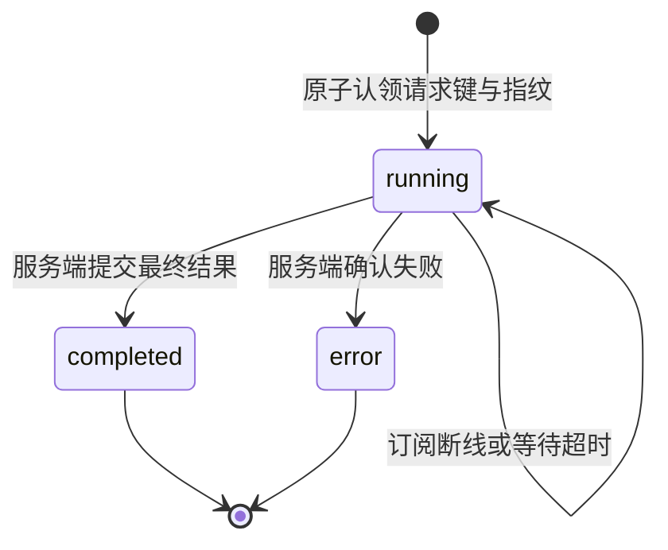
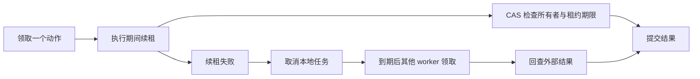

# 状态机与恢复契约

本文对应代码审查中的 I01–I29 和 H01/H02。业务状态仍以数据库、Redis 回执和实际外部状态为准；一次函数调用的阶段不冒充持久化工作流。

## 三种建模方式

- **持久状态转换表 `Machine`**：检查合法的 `old → new`，允许合法状态原地更新。由 SQL CAS、Redis WATCH 或本地锁保障并发一致性。未知状态即使原地更新也拒绝。
- **操作协议 `Protocol / Flow`**：声明 `当前阶段 + 事件 → 下一阶段`，调用 `send()` 推进。每次调用独立创建实例，未声明事件会抛出 `IllegalTransition`，自循环必须显式声明。
- **派生状态**：从截止时间、版本、租约、跨表记录计算。`work_phase`、`approval_phase`、`cache_state` 等只读投影不额外落库，避免出现两份互相矛盾的状态。

基础实现：[core/states.py](../core/states.py)、[core/protocols.py](../core/protocols.py)。前端事件表及纯函数：[stateMachine.js](../frontend/src/lib/stateMachine.js)。

历史事项续接不新增第二套流程状态：`TaskHistory.continue_task` 在同一事务内重新打开原事项并写入唯一的只读跟进事件，仍由原任务队列推进；相同请求重放不再次打开或排队。引用关系没有独立审批状态，每次读取均重新授权。私人会话与回执的所有状态键使用租户和用户作用域，旧无租户记忆不作为状态恢复兜底，详见 [ADR 0016](adr/0016-identity-scope-and-task-history.md)。

## 三个确定缺陷

| 问题 | 修复后的契约 | 回归证据 |
|---|---|---|
| 工具半开探测被取消后永久占用 | 取消只释放相同 generation 的探测，回到 open 并重新冷却；迟到回调不能改变新探测 | `test_cancelled_tool_probe_can_recover_and_late_cancel_cannot_close_new_probe` |
| `/chat/stream` 同键不同消息或会话回放旧结果 | owner 与消息/会话指纹一起原子认领；相同身份的冲突返回 409，相同内容回放；其他身份走原有鉴权拒绝 | `test_stream_binding_and_terminal_event_are_atomic`、`test_stream_request_key_binds_message_and_conversation` |
| pending 审批无人点击便永不过期 | worker 每轮扫描到期审批，通过 CAS 将状态、审计、通知一起提交；截止时刻即过期 | `test_worker_expires_unattended_approval_once_at_deadline` |

## 完整映射

这些编号代表功能组，一个功能组可能包含主状态与子协议。表中的阶段为主要路径；错误、取消和终态以对应代码中的转换表为准。

| 编号 | 流程 | 显式模型与主要阶段 | 接入点 |
|---|---|---|---|
| I01 | 多轮槽位与意图 | `SlotState / SLOTS`：empty → clarifying ↔ ready；领域、实体仍为原始数据 | [conversation_state.py](../agents/conversation_state.py)、[agents/states.py](../agents/states.py) |
| I02 | 回合与回执 | `TURN`：new → running → approval/responding → committed → finished；已有回执 → replayed | [chat.py](../api/routes/chat.py) |
| I03 | 本轮写工具防重 | `OnceState`：available → consumed；先消费本轮名额再 await，失败不自动释放；`TOOL_CALL` 检查调用阶段 | [base_agent.py](../agents/base_agent.py) |
| I04 | 模型与工具循环 | `MODEL_RUN`：generating → correcting/completed/partial/failed/cancelled；纠正仅一次，轮数预算沿用原限制 | [agents/states.py](../agents/states.py)、[base_agent.py](../agents/base_agent.py) |
| I06 | 服务端 SSE | `StreamState / STREAM`：running → completed/error；终态后拒绝追加任何事件 | [events.py](../core/events.py) |
| I07 | 浏览器 SSE | `STREAM`：opening → reading ↔ resuming → completed/failed/interrupted；不确定失败保留请求键 | [backends.js](../frontend/src/lib/backends.js) |
| I08 | 回答草稿 | `DRAFT`：absent → writing ↔ empty → removed；移除后忽略迟到增量 | [answerDraft.js](../frontend/src/lib/answerDraft.js) |
| I09 | 异步请求代次 | `requestPhase`：current/stale；每槽最新请求、身份和后端快照决定有效性 | [requestState.js](../frontend/src/lib/requestState.js)、[App.vue](../frontend/src/App.vue) |
| I10 | UI 活动、卡片与轮询 | `ACTIVITY` idle/busy；`resourceState` unloaded/loading/ready/failed；轮询 stopped/running，重复启动不增加定时器 | [stateMachine.js](../frontend/src/lib/stateMachine.js)、[ApprovalCard.vue](../frontend/src/components/ApprovalCard.vue) |
| I11 | 浏览器认证与 PKCE | `tokenState` missing/invalid/valid/expired；`LOGIN` callback → exchanging → authenticated/failed；校验 state 后一次性消费 verifier | [auth.js](../frontend/src/lib/auth.js) |
| I12 | 飞书租户令牌 | `CredentialState` missing/valid/expired；锁内重新检查有效期，再刷新 | [feishu.py](../intake/feishu.py) |
| I13 | 锁与租约 | `LEASE` waiting → held → lost/released；无法获取 → unavailable；原生 `asyncio.Lock` 保留 FIFO 互斥 | [concurrency.py](../core/concurrency.py) |
| I14 | 后台画像合并 | `JOB` idle → queued → running → dirty → running/idle；`SERVICE` 管理 worker 启停 | [concurrency.py](../core/concurrency.py) |
| I15 | 记忆压缩与归档 | `COMPRESSION` snapshot → summarizing → validating → committed → archived/archive_pending；快照冲突可重试或 defer | [memory/states.py](../memory/states.py)、[conversation_memory.py](../memory/conversation_memory.py) |
| I16 | 画像提炼节奏 | `profile_phase` waiting/due；`MAINTENANCE` checking → compressing → extracting → finished/deferred；成功才推进水位 | [memory/states.py](../memory/states.py)、[conversation_memory.py](../memory/conversation_memory.py) |
| I17 | 审批草稿、票数、过期、撤回和策略 | `APPROVAL` draft → pending（申请人确认，ADR 0020）→ 持久终态（含申请人撤回 `withdrawn`）；`approval_phase` awaiting_first_vote/awaiting_quorum/expiry_due；到期扫描、确认、撤回与策略校验是状态推进事件，与投票共用 CAS | [workflow/lifecycle.py](../workflow/lifecycle.py)、[store.py](../workflow/store.py) |
| I18 | 动作租约、时间与顺序 | `WorkPhase` waiting/ready/blocked/leased/reclaimable/review/settled；SQL 排除前序阻塞；即时领取、续租、到期写隔离 | [workflow/lifecycle.py](../workflow/lifecycle.py)、[worker.py](../workflow/worker.py) |
| I19 | 外部副作用 | `EFFECT` claimed → preflight/baseline/observing → applying → verifying → verified → committed；漂移进入 review | [workflow/lifecycle.py](../workflow/lifecycle.py)、[worker.py](../workflow/worker.py) |
| I20 | Saga 聚合 | `approval_phase` 从 apply 和 revoke 两类动作计算 compensating/manual_review/failed；原有 `EXECUTION` 只汇总 apply，不改变其含义 | [workflow/lifecycle.py](../workflow/lifecycle.py)、[store.py](../workflow/store.py) |
| I21 | 授权后回收 | `approval_phase` active_until_revocation → revoking → completed/manual_review；提前归还只把已排期的 revoke 动作提前，不新增状态；`GRANT` 仍记录权限账本状态 | [workflow/lifecycle.py](../workflow/lifecycle.py)、[ApprovalCard.vue](../frontend/src/components/ApprovalCard.vue) |
| I22 | IM 接入、顺序与通知 | `ADMISSION` new → ignored/eligible → queued/duplicate；`INBOX/OUTBOX` 保持持久状态；租约、前序阻塞单独派生 | [im.py](../intake/im.py) |
| I23 | MCP 首次可用与工具目录 | `STARTUP` pending → available/unavailable；`CATALOG` empty → refreshing → ready → empty/closed；连接仍用 `CONNECTION` | [mcp_client.py](../tooling/mcp_client.py) |
| I24 | 缓存与惰性实例 | `CacheState` missing/fresh/stale，按 TTL 与版本计算；技能热加载使用 `SNAPSHOT` empty/loading/ready/degraded/failed | [protocols.py](../core/protocols.py)、[skill_loader.py](../core/skill_loader.py)、[tool_manager.py](../tooling/tool_manager.py) |
| I25 | 文档、索引与 embedding 版本 | `DOCUMENT_UPDATE` prepared → writing → committed → indexed；`MIGRATION` scanning → embedding → writing → scanning/completed | [knowledge_base.py](../tooling/knowledge_base.py)、[vector_store.py](../core/vector_store.py) |
| I26 | 告警迟滞 | `AlertPhase / ALERT_PHASE` firing ↔ clearing → resolved；在监控读模型中公开 phase，持久含义仍用 `ALERT` | [performance_monitor.py](../monitor/performance_monitor.py) |
| I27 | 应用与资源生命周期 | `APPLICATION` starting → ready/degraded → stopping → closed；`SERVICE` 管理 worker/monitor；`AsyncExitStack` 在启动失败时也释放已获取资源 | [main.py](../api/main.py)、[protocols.py](../core/protocols.py) |
| I29 | 评测会话 | `TRIAL` dialogue → user_stop/max_turns → approving → grading → completed/failed | [evaluate_simulated.py](../scripts/evaluate_simulated.py) |
| H02 | 工具熔断 | `CIRCUIT` closed → open → half_open → closed/open；取消与迟到回调受 generation 限制 | [tool_manager.py](../tooling/tool_manager.py)、[executor.py](../tooling/executor.py) |

原状态建模保留八张转换表：`APPROVAL`、`EXECUTION`、`ACTION`、`GRANT`、`INBOX`、`OUTBOX`、`CONNECTION`、`ALERT`（画像改为整份修订的短文档后，`FACT` 事实生命周期表已删除）。后续共享事项迁移另外引入持久回合和核验记录，边界见下文及相应 ADR。

共享事项的核验队列：`queued → running → passed / failed / unknown`；运行租约到期可重新领取，最多三次。排队或运行中的检查可因目标变更、停止或新检查而进入 `stale / cancelled`。结果提交同时检查租约、目标版本、进度版本及当前任务运行状态；旧结果不能唤醒重规划。只有 `failed` 可以在目标预算内唤醒最多两轮只读跟进，`unknown` 转人工。

共享事项回合的恢复由 [检查点服务](../workflow/task_checkpoints.py) 持久化到冻结输入、Agent 调用、聚合结果和进度建议四个边界。详细恢复与验收契约见 [ADR 0015](adr/0015-task-execution-verification.md)。

## 关键恢复路径



订阅者超时只说明没有等到事件，不能推断执行已经停止。服务端返回 `retry_same_request: true`；浏览器保留同身份、同后端、同会话、同消息的请求键。重新发送时回放原流。收到终态后立即停止读流，不必等待连接 EOF。请求键与事件流仍受原有保留期限制，浏览器键目前只在页面内存中保存。



动作不再整批领取后串行等待。同一动作每轮最多尝试一次，避免零延迟重试耗尽预算。审批动作与 IM 消息均定期续租，结算 SQL 拒绝过期租约；IM 使用版本作为领取代次，审批动作使用所有者和 attempts。顺序约束在候选查询和领取事务内均检查。

记忆压缩在同一 Redis 事务中写摘要、裁剪列表、记录待归档正文。向量归档使用确定性 ID，可重复 upsert；成功后才删待办。后台维护在启动后及每 30 秒扫描一页待办，不依赖该会话再来一条消息。进程崩溃后的可恢复性取决于 Redis 的持久化配置。

知识库替换把新分片 upsert 与旧分片删除放在同一 SQL 事务。embedding 迁移先检查返回数量，更新时同时比较读取到的正文和模型，避免覆盖迁移期间的文档改动。

应用停止时先关闭监控、IM 和动作 worker，再等待在途聊天任务，最后按退出栈释放资源。启动尚未完成就失败时，同样执行释放流程。`/health.lifecycle` 显示应用阶段；审批响应增加 `lifecycle`，动作增加 `phase`，监控告警增加 `phase`，MCP 增加 `startup/catalog`，技能摘要增加 `phase`。

## 保留的边界

- 取消不能撤回已经到达外部系统的请求，也不能强制中止已开始的 `to_thread` 调用。跨系统仍依赖幂等键、结果回查和人工核对，不宣称 exactly-once。
- SQL 审批与 Redis 回执仍不是一个分布式事务。确定性审批 ID、会话锁、回执重放承担恢复职责。
- `execution=failed` 不表示所有副作用都已撤销。`lifecycle=compensating/manual_review` 暴露回收阶段，具体结果仍需查看动作与权限账本。
- `Flow` 是进程内协议检查，不提供任意指令位置的持久化续跑。评测 partial 报告和技能候选账本仍不支持自动恢复半轮评测。
- 技能晋升先验证和读取所有目标，再逐文件原子替换；多个文件不构成一个事务，机器崩溃仍可能留下部分晋升，需要检查 diff 后重试。
- Shell 启动脚本继续使用进程存活、端口健康检查和退出码作为原生状态来源；没有再写一份持久化 PID 状态。时间、计数器、缓存版本和 SDK 内部工具轮次也保持其原生来源。

## 验证

[test_protocol_regressions.py](../tests/test_protocol_regressions.py) 覆盖取消探测、请求认领冲突、终态隔离、主动过期、租约丢失、过期写拒绝、归档重放、文档事务回滚和启动失败清理；[test_chat_endpoint.py](../tests/test_chat_endpoint.py) 通过真实路由检查 409 与流回放；[chatStream.test.js](../frontend/tests/chatStream.test.js) 检查超时续传、身份隔离及终态不等待 EOF。

```bash
.venv/bin/python -m pytest -o addopts='' -q
.venv/bin/ruff check agents api core evaluation intake memory monitor tooling workflow tests/test_protocol_regressions.py scripts/evaluate_simulated.py
cd frontend
npm test
npm run build
```

离线测试使用 SQLite、fakeredis 和模拟模型。真实 Keycloak/Gitea 集成测试需显式配置服务；当前修改没有用生产服务、真实模型或浏览器交互验证。
